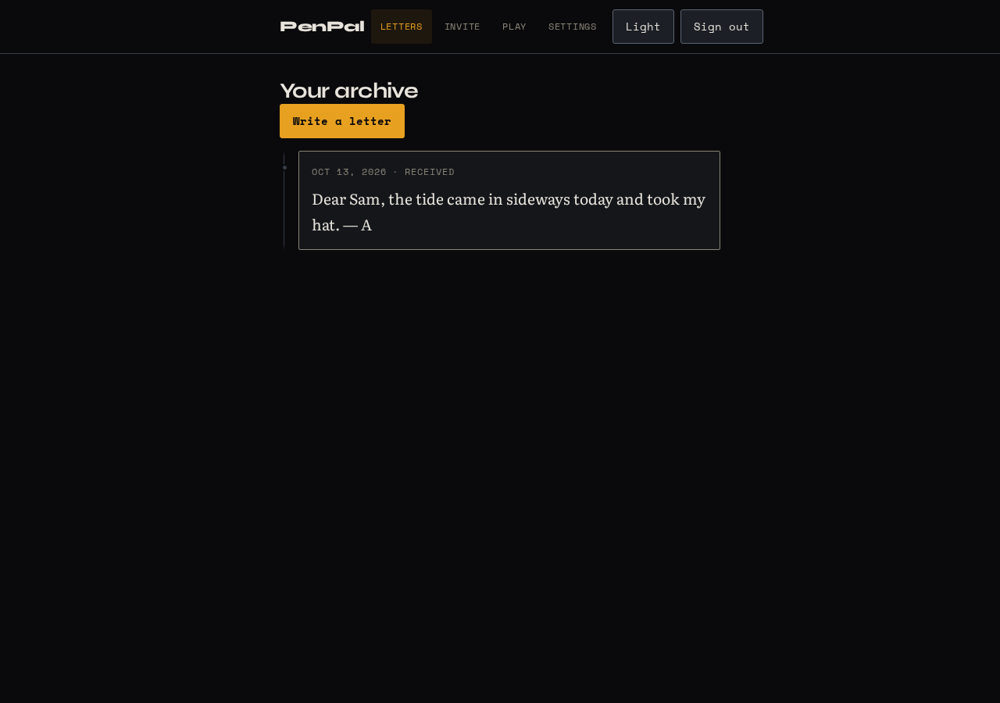
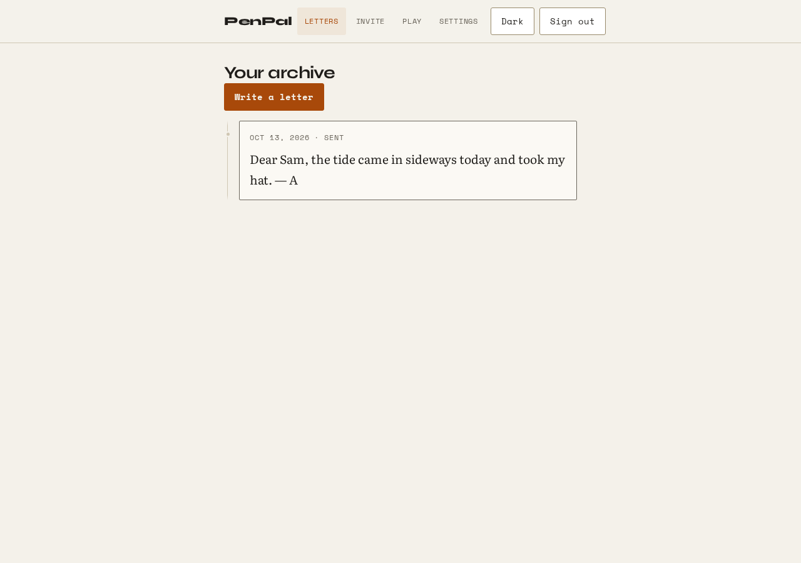
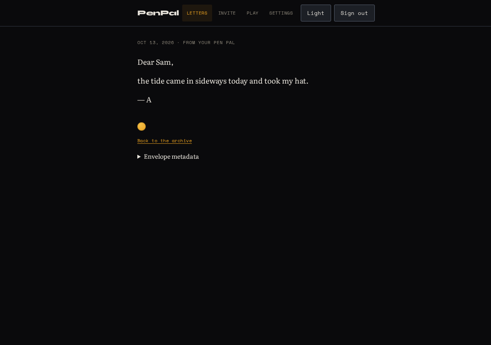
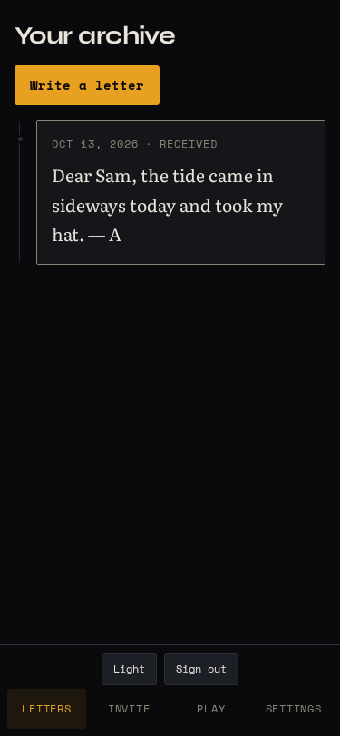
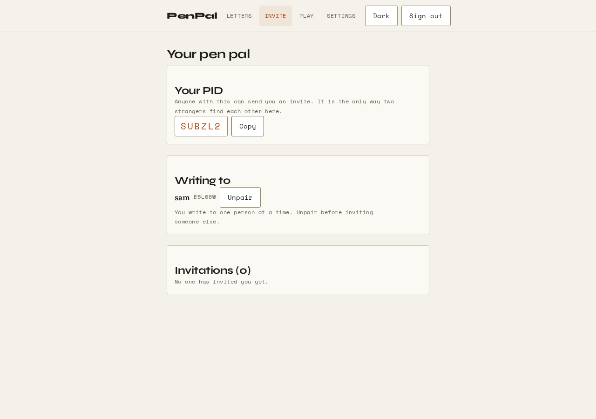

<div align="center">

# PenPal

**A letter takes time. That is the feature.**

Self-hosted, end-to-end encrypted correspondence between exactly two people.

`React` `TypeScript` `Express` `SQLite` `Docker` `WCAG 2.2 AA`

</div>

---

## Why this exists

Messaging apps made communication instant, and something was quietly lost.
Slowly reintroduced letters: sealed, addressed by a six-character code, and
carried at the speed of post. You cannot edit a letter after sending it. You
cannot read the reply before you have written one worth answering.

PenPal is that idea, self-hosted and actually encrypted. You and one other
person. No feed, no followers, no algorithm, no second pairing.

The interface follows the metaphor. Paper, ink, a wax seal, a postmarked line
carrying the date and the distance. Letters hang on a spine rather than sitting
in a grid of identical cards. Nothing bounces or shimmers.

<p align="center">
  
  
</p>

Open a letter and it is set in a reading serif at a comfortable measure, because
it is prose and someone wrote it for you.

<p align="center">
  
</p>

## What it actually does

- **One partner.** Not a friend list. One person, enforced by the database.
- **Real E2E encryption.** Per-letter AES-256-GCM, content key wrapped to both
  parties with RSA-OAEP-2048. The server stores ciphertext it cannot read.
  If encryption fails, the letter is **not sent** — it will not quietly fall
  back to plaintext.
- **Scheduled delivery.** Seal a letter with a date and the recipient sees
  nothing until it is due. You see it waiting in transit.
- **Encrypted profiles.** Photos are re-encoded server-side with `sharp`;
  EXIF, GPS and any appended payload are stripped and verified gone.
- **Chess**, on a rules engine verified by perft against published move counts.
- **Two themes**, both contrast-checked in CI, not eyeballed.

<p align="center">
  
  
</p>

## Status — read this

**Not production-ready.** This is honest, not throat-clearing.

`v0.0.2` is tagged and archived. It shipped broken: the login form posted to a
route that did not exist, so **the app could not be logged into at all**, and the
encryption module exported four functions that nothing ever called. Branch
[`v2`](https://github.com/2kfi/pen-pal/tree/v2) is the current work.

Known gaps, stated plainly:

- **Uploaded photos are stored unencrypted at rest.** Letter bodies are
  encrypted; attachments are not. They sit behind an authenticated route, not
  behind cryptography. Closing this means encrypting in the browser before
  upload.
- **Chess has no engine.** Two players, one device. A Web Worker search is
  planned, not shipped.
- One chess perft position is short by 1 and 51 nodes against published values.
  Unrooted, and tracked rather than hidden.
- Notifications are poll-only. No push, no offline queue, no SSE.

## Requirements

Browsers only expose `crypto.subtle` in a **secure context**. Serve this over
HTTPS. Over plain `http://192.168.x.x` there is no encryption path at all, and
the app will refuse to send rather than pretend. `localhost` counts as secure,
so local development is unaffected.

```caddy
penpal.example.com {
    reverse_proxy localhost:3000
}
```

## Run it

```bash
cp .env.example .env
sed -i "s|^JWT_SECRET=.*|JWT_SECRET=$(openssl rand -base64 32)|" .env
docker compose up -d --build
```

Then open `http://localhost:3000`, create an account, and read
**[docs/SELF-HOSTING.md](docs/SELF-HOSTING.md)** for TLS, backups and finding
your pen pal.

<details>
<summary>Running without Docker</summary>

```bash
npm install && npm --prefix client install
npm run build --prefix client    # note: the root `npm run build` does NOT build the client
npm start                        # http://localhost:3000
```

</details>

## API

| Method | Path | |
|---|---|---|
| `GET` | `/healthz` | liveness |
| `POST` | `/api/signup` | create account (generates your keypair) |
| `POST` | `/api/login` | sign in |
| `GET`/`PUT` | `/api/me` | profile |
| `POST` | `/api/pairing/request` | invite by PID |
| `GET` | `/api/pairing/status` | pending invites, current partner |
| `POST` | `/api/pairing/accept` · `/reject` | respond |
| `DELETE` | `/api/pairs/unpair` | end the pairing |
| `POST` | `/api/letters/send` | send a sealed letter |
| `GET` | `/api/letters/sync` | fetch (withholds undelivered letters) |
| `POST` | `/api/photos/upload` | attachment, sanitised |
| `GET` | `/api/notifications` · `PUT` `/read` | updates |

## Configuration

| Variable | Default | |
|---|---|---|
| `PORT` | `3000` | |
| `JWT_SECRET` | — | **required** in production; the server refuses to boot without it |
| `CORS_ORIGIN` | same-origin | comma-separated allowlist |
| `ADMIN_TOKEN` | — | enables `POST /api/admin/reset-db` (non-production only) |
| `DATA_DIR` | `./data` | SQLite location |

## Development

```bash
npm run design:check      # contrast gate — fails on any regression
npm run lint
npm test                  # API
npm --prefix client test  # crypto round-trips + chess perft
npm run e2e               # Playwright, two real users
```

The E2E suite is the only test that proves encryption actually works: every
other test hands the API ciphertext it already holds. It drives two browser
contexts through a full exchange and then reads the SQLite file to assert the
plaintext is nowhere in it.

## Documentation

- [`docs/DESIGN.md`](docs/DESIGN.md) — the design system: type, colour, motion, accessibility floor
- [`docs/SELF-HOSTING.md`](docs/SELF-HOSTING.md) — TLS, backups, upgrades
- [`docs/HANDOFF.md`](docs/HANDOFF.md) — what is done, what is not

## License

ISC